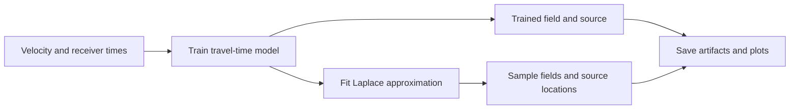

# Laplace HypoPINN: physics-informed earthquake localization

**Laplace HypoPINN** is a Python/PyTorch research package for earthquake and
microseismic hypocenter localization with physics-informed neural networks (PINNs).
Given a velocity model and receiver travel times, it learns a two-dimensional
travel-time field constrained by the Eikonal equation, estimates the source
location, and uses Laplace approximations to explore local network-weight uncertainty.

[Documentation](https://izzatum.github.io/laplace-hypopinn/) ·
[Tutorial notebooks](examples/notebooks/README.md) ·
[Common questions](https://izzatum.github.io/laplace-hypopinn/faq/) ·
[Research paper](https://doi.org/10.1088/2632-2153/ac94b3)

This repository accompanies Izzatullah et al. (2022), *Laplace HypoPINN:
physics-informed neural network for hypocenter localization and its predictive
uncertainty*. The maintained package adds configurable models, functional APIs
and explicit research variants while preserving the original notebooks.



## Quick start

Python 3.12+; CPU is sufficient. Clone the repository, then run:

```bash
git clone https://github.com/izzatum/laplace-hypopinn.git
cd laplace-hypopinn
python -m venv .venv
source .venv/bin/activate
python -m pip install -e '.[plot]'
python -m laplace_hypopinn run --smoke --threads 1 --output results/smoke
python -m laplace_hypopinn plot results/smoke
```

The smoke example uses two training updates and three posterior samples. It checks
execution, not published accuracy or calibrated uncertainty. Results include
configuration, metrics, arrays, a checkpoint and PNG plots. Use a new output path
for each run; existing results are protected from overwrites.

## Learn the methods

Start with the [eight tutorial notebooks](examples/notebooks/README.md), one per
method: `legacy_diagonal`, `diagonal`, `block_diagonal`, `full`, `kfac`, `efb`,
`inf` and `valla`. Each walks through data preparation, training, fitting and
sampling, with six saved figures and a small CPU teaching budget. The tutorial
index includes installation and Jupyter instructions.

The [method reference](docs/methods.md) explains approximation targets, damping
and sampling assumptions. The six [original research notebooks](archive/README.md)
are preserved separately with their historical code and outputs.

## Extend the research

Change model depth and width with `--widths`, select an approximation with
`--method`, or load a TOML configuration with `--config`:

```bash
python -m laplace_hypopinn run --smoke --threads 1 \
  --widths 2,32,32,1 --method diagonal --output results/custom
```

The Python API accepts named parameter tensors and a pure forward function, or
an adapted `torch.nn.Module`. See the [extension contracts](docs/architecture.md)
and [observed-data example](examples/extend_research.py). Custom models must be
deterministic, differentiable pointwise scalar maps; KFAC/EFB/INF need compatible
coordinate-derivative adapters.

[Presets and reproduction guidance](docs/reproducibility.md) cover full historical
budgets and paper/notebook differences. Read the [performance guide](docs/performance.md)
before scaling up. Coordinates are `(z,x)` in km, velocity km/s and travel time seconds.

**Can I use a different PINN architecture?** Yes: depth and widths are configurable,
and custom scalar models can supply a functional forward or `torch.nn.Module` adapter.
**Do I need a GPU?** No: the tutorials and tests run on CPU.
**Are the uncertainty estimates calibrated?** Calibration is not established by
the teaching examples; damping, likelihood assumptions and approximation choices
are documented in the [methods](docs/methods.md) and [FAQ](https://izzatum.github.io/laplace-hypopinn/faq/).

For development and the full test suite:

```bash
python -m pip install -e '.[dev,plot,fast-marching,notebooks]'
python -m ipykernel install --sys-prefix --name laplace-hypopinn
python -m pytest -q
python -m ruff check .
```

## License and citation

The maintained code, documentation and tutorials are available under the
[MIT License](LICENSE). The historical archive and bundled data are excluded
from this grant; see [third-party notices and scope](THIRD_PARTY_NOTICES.md).

For research use, please cite Izzatullah et al. (2022), *Laplace HypoPINN*,
[DOI: 10.1088/2632-2153/ac94b3](https://doi.org/10.1088/2632-2153/ac94b3), and the
relevant approximation sources in the method reference. [CITATION.cff](CITATION.cff)
provides citation metadata.
