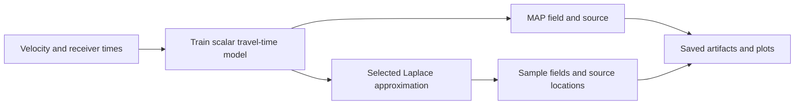

# Laplace HypoPINN

Physics-informed travel-time inversion, hypocenter localization and local
network-weight uncertainty, with functional PyTorch research APIs and preserved
[original notebooks](archive/README.md).



Python 3.12+; CPU is sufficient. From the repository root:

```bash
python -m venv .venv
. .venv/bin/activate
python -m pip install -e '.[dev,fast-marching,plot]'
python -m pytest -q
```

A small execution check (two updates, tiny grid, three posterior samples):

```bash
python -m laplace_hypopinn run --smoke --threads 1 --output /tmp/hypopinn-smoke
python -m laplace_hypopinn plot /tmp/hypopinn-smoke
python examples/extend_research.py --output /tmp/hypopinn-observed
```

Use fresh output paths: existing runs and figures are protected from overwrites.
Full historical budgets are explicit and substantially more expensive:

```bash
python -m laplace_hypopinn run --preset ex2 --output /tmp/hypopinn-ex2-full
python -m laplace_hypopinn run --preset ex3 --velocity-path "$PWD/otway2.csv" --output /tmp/hypopinn-ex3-full
```

`ex1` compares four initializations; `ex2`, `ex3`, `ex3_2`, `ex3_3` fit uncertainty.
Choose `--method` from `legacy_diagonal`, `diagonal`, `block_diagonal`, `full`,
`kfac`, `efb`, `inf`, `valla`; [method definitions and sources](docs/methods.md)
explain their distinct targets. A smoke run demonstrates execution, not published
accuracy or calibrated uncertainty.

Depth and width are configurable; the notebook's 2,737-parameter Mish network is
an example preset, not a model-size constraint. Custom models use named tensors:

```python
from dataclasses import replace
import torch
from laplace_hypopinn.experiment import run_experiment
from laplace_hypopinn.model import module_adapter
from laplace_hypopinn.presets import load_preset

config = load_preset("ex2")
config = replace(config,
    model=replace(config.model, widths=(2, 8, 12, 8, 1), activation="tanh"),
    data=replace(config.data, collocation_count=8, grid_shape=(9, 11)),
    training=replace(config.training, steps=2),
    laplace=replace(config.laplace, method="diagonal", samples=3))
run_experiment(config, output="/tmp/hypopinn-python")

class Quadratic(torch.nn.Module):
    def __init__(self):
        super().__init__()
        self.center = torch.nn.Parameter(torch.tensor([0.8, 1.2]))
    def forward(self, q):
        return (q - self.center).square().sum(-1, keepdim=True)

parameters, forward = module_adapter(Quadratic().eval())
run_experiment(config, parameters=parameters, forward=forward,
               output="/tmp/hypopinn-custom")
```

Custom forwards must be deterministic, differentiable, pointwise scalar maps;
structured methods need a compatible jet adapter. See [architecture and extension
contracts](docs/architecture.md), [reproducibility and paper differences](docs/reproducibility.md),
[performance](docs/performance.md), and the executable [observed-data example](examples/extend_research.py).
Coordinates are `(z,x)` in km, velocity km/s, and travel time seconds.

For archival execution install `'.[notebooks]'` and follow the
[archive runner instructions](archive/README.md). Cite Izzatullah et al. (2022),
*Laplace HypoPINN*, [DOI: 10.1088/2632-2153/ac94b3](https://doi.org/10.1088/2632-2153/ac94b3);
see [citation metadata](CITATION.cff). Archival preservation grants no additional
software-license permissions.
