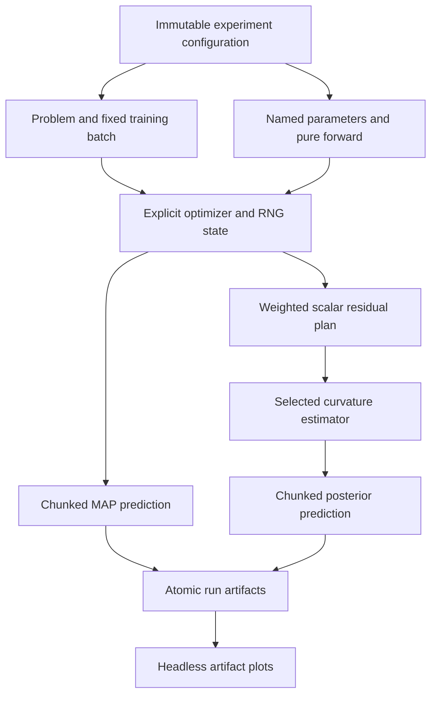

# Functional research architecture

The maintained package separates physical observations, model evaluation,
optimization, local curvature, prediction and artifact publication. The six
[archived notebooks](../archive/README.md) remain independent historical sources.
See [scientific conventions](methods.md), [reproduction limits](reproducibility.md)
and [measured performance guidance](performance.md) before comparing runs.

## Configuration and physical inputs

Frozen dataclasses in `config.py` define model, data, training, Laplace and
prediction settings. `presets.load_preset` returns historical examples;
`dataclasses.replace` makes a new configuration. `presets.load_config` reads
strict TOML, rejects unknown fields and resolves data paths relative to the
configuration file. Installed wheels require explicit external Otway/observation
paths; data discovery does not depend on the process working directory.

A `Grid` stores one-dimensional z and x axes plus velocity with shape `(nz,nx)`.
Coordinates always use `(z,x)` in km; velocity is km/s and travel time seconds.
A `Problem` stores grid, receiver coordinates and receiver times; reference travel
times and true source are optional. Observed-data inversion requires neither.
`prepare_problem` loads or generates data; `sample_training_batch` chooses
collocation points from explicit `RandomStreams`. Synthetic fast marching imports
its optional dependency only when needed.

## Model and extension contracts

Parameters are insertion-ordered mappings from arbitrary names to tensors.
`flatten_parameters` records names, shapes and block layout;
`unflatten_parameters` returns differentiable views, including batched draws.
Built-in affine layers use row-major augmented `[W|b]` blocks. Custom mappings
retain their declared tensor order; names do not imply affine semantics.

The built-in scalar MLP accepts any positive layer widths beginning with 2 and
ending with 1, with arbitrary depth and supported Mish, tanh or SiLU activation.
The six hidden layers and 2,737 parameters are a regression fixture and default
preset, not a runtime restriction. `initialize_model` consumes an explicit
random generator and `make_mlp_forward` selects activation independently of
mutable module state.

Supply `run_experiment(config, parameters=parameters, forward=forward)` to replace
the built-in model. A forward has signature `forward(parameters, coordinates)`;
it must be deterministic, pointwise, differentiable through coordinate and
parameter derivatives, and return `(n,)` or `(n,1)` scalar times. `module_adapter`
snapshots an eval-mode `torch.nn.Module`, including isolated buffers, into this
interface using `torch.func.functional_call`. Only trainable parameters enter the
optimization and posterior layout; frozen parameters remain isolated constants
that are copied for each call, and models with no trainable parameters are rejected.
The caller supplies the module's initialization and matching dtype/device. See the [README example](../README.md)
and [custom observed-data experiment](../examples/extend_research.py).

Generic legacy diagonal, direct GGN and VaLLA paths use functional derivatives.
Structured KFAC/EFB/INF require supported affine/activation coordinate jets or an
explicit compatible `jet_adapter`; unsupported custom models fail explicitly.
The direct block method uses affine-layer blocks for recognized MLP layouts;
arbitrary tensor mappings need an explicitly meaningful partition. Choose a
generic diagonal/full method when that partition is unavailable.

## Training, residuals and posterior sampling

`training.train` owns local optimizer and scheduler state and returns parameters,
logged losses and resumable training state. Checkpoints preserve RNG and optimizer
state; training resume does not by itself validate a complete experiment, data
source or arbitrary custom forward. No package-global model, device, RNG or
configuration drives computation.

The legacy diagonal uses batch-size-weighted squared gradients of total mean
loss. Corrected methods consume a fixed weighted scalar residual plan with
normalization based on full family counts. Chunking changes working memory,
not residual weights. KFAC prerequisites are constructed only for selected
KFAC/EFB/INF methods; importing the package fits no approximation. The
[method reference](methods.md) defines precision, damping, ordering and sampling
for legacy diagonal, diagonal/block/full GGN, KFAC, EFB, INF and VaLLA.

`prediction.predict_grid` evaluates coordinate chunks. `sample_locations` streams
parameter draws, grid minima and field moments, without retaining every field.
`save_posterior_fields=True` explicitly writes a disk-backed posterior field
store. Random streams, precision factors, device and dtype belong to run state.
VaLLA's QR/projection and compact variance/KL algebra explicitly use float64 on
the model's device; public results retain model dtype. The
[method reference](methods.md) records this numerical policy. The reported
locations are discrete grid minima; resolution affects localization.

## Saved artifacts and plotting

`experiment.run_experiment` stages a run, rejects existing output paths and
publishes completed artifacts. Each run contains:

| Artifact | Contents |
| --- | --- |
| `config.json` | Resolved dataclass settings |
| `metrics.json` | Method conventions, hashes, provenance, timings and training history |
| `arrays.npz` | Physical axes, velocity, receivers/times, MAP field and MAP location |
| `checkpoint.pt` | Training parameters, optimizer, scheduler and RNG state |
| `posterior_fields.npy` | Optional disk-backed complete sampled fields |

Arrays additionally contain truth/reference fields when supplied, and posterior
locations, mean/std locations and streamed field moments when sampled. EX1 writes
separate initialization subdirectories. A source-tree hash, source revision when
available, dependency versions and model identity accompany outputs. A custom
callable's recorded name is provenance, not serialized source code. Retain custom
code to reproduce it.

`plotting.plot_run(run_directory, output_directory=None)` reads these saved arrays
and optional history, imports Matplotlib lazily and returns PNG paths. The default
output is `run_directory/plots`. Direct Agg canvases work without a display;
figures are closed after saving. Field axes show physical x/z in km with depth
increasing downward, colorbars show seconds or km/s, and source markers come from
saved receiver, MAP, posterior and optional true-source coordinates. Observed
runs need no truth. Existing target figures are rejected before writing.
