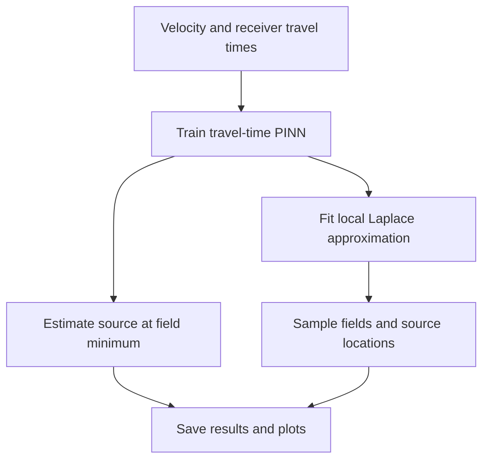

# Laplace HypoPINN

**Laplace HypoPINN is a Python/PyTorch research package for seismic hypocenter
localization using physics-informed neural networks (PINNs) and Laplace
approximations.** Given a velocity model and receiver travel times, it learns a
travel-time field constrained by the eikonal equation. The field minimum estimates
the source location; sampled fields show variation induced by local uncertainty
in the neural-network weights.

The project supports research into earthquake and microseismic event localization.
The maintained package version is **0.1.0**.
It develops the implementation accompanying [Izzatullah et al. (2022)](citation.md)
with a functional Python API, configurable networks, saved experiment artifacts,
and eight [Laplace approximation tutorials](tutorials.md). Its current spatial
model is two-dimensional, with coordinates `(z,x)` in km, velocity in km/s and
travel time in seconds.

## Run a first experiment

Use Python 3.12 or later. Clone the [GitHub repository](https://github.com/izzatum/laplace-hypopinn)
and install the package from the checkout:

```bash
git clone https://github.com/izzatum/laplace-hypopinn.git
cd laplace-hypopinn
python -m venv .venv
source .venv/bin/activate
python -m pip install -e '.[plot]'
python -m laplace_hypopinn run --smoke --threads 1 --output results/smoke
python -m laplace_hypopinn plot results/smoke
```

CPU is sufficient for this example. The smoke run uses two training updates and
three posterior samples to check execution. It saves configuration, metrics,
arrays, a checkpoint and plots; it does not establish research accuracy. Use a
new output directory for each run.

## Research workflow



- **Learn by running code:** the [eight tutorials](tutorials.md) cover historical
  diagonal, GGN diagonal, block diagonal, full, KFAC, EFB, INF and VaLLA, with
  saved figures and method-specific diagnostics.
- **Choose an approximation:** the [method reference](methods.md) defines the
  curvature targets, damping and prediction conventions.
- **Extend an experiment:** the [architecture guide](architecture.md) explains
  pure forward functions, custom models, observed data and explicit random state.
- **Compare results responsibly:** the [reproduction guide](reproducibility.md)
  documents historical presets and paper/notebook differences; the
  [performance guide](performance.md) records measured CPU runs and their limits.

The approximations describe local network-weight uncertainty. They do not alone
establish calibrated uncertainty in velocity, arrival picks or source location.
See the [FAQ](faq.md) for these distinctions, model requirements and data use.

The maintained package, documentation and new tutorials use the
[MIT License](https://github.com/izzatum/laplace-hypopinn/blob/main/LICENSE).
[Separate terms](https://github.com/izzatum/laplace-hypopinn/blob/main/THIRD_PARTY_NOTICES.md)
apply to the historical archive and bundled data. The [citation page](citation.md)
provides the paper reference and links to method sources.
