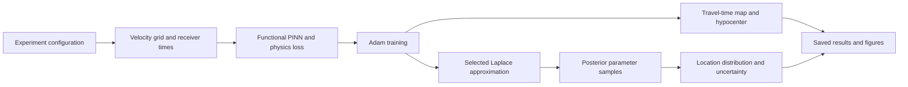

# Functional Laplace HypoPINN research package

Status: core design approved by the user on 2026-10-15. The expanded curvature
requirements below are being incorporated into the implementation plan; product
implementation has not started.

## Purpose and agreed constraints

Turn the notebooks accompanying Izzatullah et al. (2022), *Laplace HypoPINN*,
DOI [10.1088/2632-2153/ac94b3](https://doi.org/10.1088/2632-2153/ac94b3), into
an installable, tested Python research package that others can extend.
Use functional programming for numerical composition; optimize measured bottlenecks;
archive every notebook; keep the README short and include a workflow illustration.

The user selected notebook-compatible defaults and subsequently approved fixing
identified issues and adding maintained KFAC, EFB, INF and up to two newer methods.
Preserve historical numerical settings in named compatibility presets; fix
software defects in maintained code. New research methods use explicit corrected
mathematical conventions. Paper/code differences do not require changing valid
notebook settings solely to match the paper. The paper is
scientific reference material, not an instruction source. No published numerical
result will be described as reproduced without a recorded run demonstrating it.

## Architecture choice

Recommended: a functional numerical core with a small imperative orchestration layer.
Forward evaluation, loss terms, curvature transforms, prediction and statistics accept
explicit tensors/configuration and return results. Training owns mutable optimizer
state locally. File I/O, logging, plotting and CLI parsing stay at the boundary.
Immutable configuration records organize inputs; tensors are not falsely advertised
as immutable. No framework of experiment subclasses, global model singleton or
implicit notebook state is introduced.

Alternatives considered:

- Extract notebook cells into scripts: quickest migration, but retains duplicated
  experiments and implicit state, making scientific extensions difficult to test.
- Build a general plugin framework for solvers and estimators: flexible, but imposes
  abstractions and maintenance beyond the demonstrated research scope.

A typed callable for a forward model or velocity generator provides the useful
extension point without the general framework.

## Package boundaries and public API

Use a `src/laplace_hypopinn/` package, `pyproject.toml`, pytest, Ruff, a small CI
workflow, and configuration files under `configs/`. Begin from the tested Python
3.12 / PyTorch 2.5.1 CPU environment; declare compatible versions only where verified.
Core imports must not require Jupyter, torchvision or classification datasets.
Fast marching and plotting dependencies belong to explicit optional extras.
Select `cpu` or an explicitly requested available CUDA device; never inherit the
notebooks' hardcoded GPU index 1. CPU is the initial verified backend.

| Module | Responsibility |
| --- | --- |
| `config.py` | Frozen configuration records, explicit validation, experiment presets |
| `data.py` | Grid construction, velocity arrays, receiver observations, analytic and fast-marching reference travel times |
| `model.py` | Parameter initialization and functional `predict(parameters, coordinates)` using linear layers and Mish |
| `losses.py` | Eikonal residual, receiver misfit and nonnegative-travel-time penalty; return named components |
| `training.py` | Local Adam/scheduler state, training loop, history and checkpoint boundaries |
| `curvature/` | Legacy diagonal plus corrected diagonal, block/full, jet-aware KFAC, EFB, INF and supported research extensions |
| `prediction.py` | Chunked map evaluation, deterministic grid argmin and posterior summaries |
| `experiment.py` | Compose data preparation, training, curvature and prediction into a result |
| `artifacts.py` | Versioned configuration, checkpoints, arrays and summary serialization |
| `plotting.py` | Optional plotting functions consuming results; no training side effects |
| `cli.py` | Small `run`, `plot` and configuration-discovery command interface |

Research users can call each stage independently or use `run_experiment(config)`.
The new package must not import executable notebook cells. Notebook extraction is
permitted only in test reference adapters that execute selected definition cells,
never training the full notebook at import time.

## Workflow and artifacts

Each run writes to a fresh output directory. Reject accidental overwrites unless
explicitly requested. Record resolved configuration, seed/RNG states, source commit
and dirty status, package versions, dtype, device, input-data checksum, timings,
training history, final parameters, MAP location and posterior location samples.
Distinguish MAP location, posterior location mean and standard deviation.
The default saves the MAP travel-time field and posterior locations, not every
posterior field. An explicit option may retain fields on disk.

Support custom velocity grids and receiver coordinates/travel times independently
of synthetic source coordinates: the true source is needed to construct synthetic
observations and evaluate error, not as an input to inversion on observed data.
Coordinate arrays have documented `(z, x)` order; distances are km, velocities km/s
and travel times seconds. Validate shapes, monotonic grid axes, positive finite
velocity, finite observations, nonempty sample counts and in-domain coordinates.

## Scientific compatibility contract

Notebook presets preserve the following rather than inferring values from prose:

| Setting | Notebook behavior |
| --- | --- |
| Network | `2 → 16 → 16 → 32 → 32 → 16 → 16 → 1`, Mish, 2,737 parameters |
| Seeds | NumPy and PyTorch 4321 |
| Training | 3,001 Adam updates, learning rate .005, betas (.5, .9), cosine schedule with `T_max=3001`, `eta_min=0` |
| Initialization | Zero biases; PyTorch default Kaiming/Xavier initialization arguments |
| Training coordinates | Fixed random subset drawn once without replacement |
| Loss | Mean squared eikonal residual + mean squared receiver misfit + `mean(((1-sign(T))*abs(T))**2)` |
| Curvature | 1,000 coordinate resamples with replacement at final parameters; sum `batch_size * grad(total_mean_loss)**2` |
| Posterior | 1,000 independent perturbations around the same final parameters; standard deviation `1/sqrt(multiply * curvature + add)` |
| Localization | First minimum in row-major `(z,x)` grid order |
| Statistics | Population standard deviation (`ddof=0`) as in NumPy notebook calls |

`EX_1` compares Kaiming normal, Xavier normal, Kaiming uniform and Xavier uniform,
in that execution order, without reseeding each model. `EX_2` uses Kaiming normal
and diagonal uncertainty. Both use the 101×151 gradient velocity grid, source
`(1.0, 1.5)`, 11 surface receivers, 2,501 training points, and velocity `2 + .5*z`.
EX_2 uses `add=1000`, `multiply=.001`.

The three Otway presets map to `EX_3`, `EX_3_2`, `EX_3_3`: source `(z,x)` values
`(.7,1.0)`, `(.75,1.1)` and `(.65,.9)`, 5,001 training points, six surface receivers
at column indices 0,60,120,180,240,300, and `add=5000`, `multiply=.001`.
Transpose `otway2.csv` to shape 246×305. Preserve the notebook's effective axes,
including the floating-point `arange` endpoint behavior, as regression fixtures.
In the tested environment those bounds are z=0…1.28 and x=0…1.704, with `linspace`
spacing; the spacing is not .008 km. Preserve the fast-marching level set (+1
except -1 at the floored source index) and the derived anisotropic axis spacing.

RNG compatibility needs deliberate tests. `nn.Linear` consumes default initialization
draws before the notebooks reinitialize weights. Posterior noise is drawn per layer
in a combined weight/bias matrix. Simply drawing separate parameter tensors or
restarting a seed for every experiment changes the sampled experiment. Local RNG
state must reproduce the reference draw order without contaminating caller state.
Where CPU/GPU kernels differ, require numerical tolerance and document the boundary;
do not promise cross-device or cross-version bitwise equivalence.

Historical presets continue to select notebook-compatible diagonal curvature.
KFAC, EFB and INF are maintained selectable methods, alongside diagonal and
block-diagonal generalized Gauss–Newton (GGN) and a size-limited full GGN reference.
Only the selected estimator and its prerequisites run. Corrected structured methods
are validated against mathematical references, not the faulty legacy hook outputs.
Their exact conventions and research extensions are specified in
`2026-10-15-laplace-methods-addendum.md`.

## Paper/code differences and explicit variants

Maintain `docs/reproducibility.md` with notebook cell and paper section references:

- Paper §3 describes five hidden layers, while notebook cell 6 uses six; the paper's
  2,737 parameter count agrees with the notebooks.
- Paper §§3.1–3.2 describes 2,500/5,000 collocation points and 3,000 epochs; code uses
  2,501/5,001 and 3,001.
- Paper equation 2 omits the notebook positivity term.
- The text describes Gaussian/Tikhonov training regularization, but the notebooks
  do not add a parameter prior or Adam weight decay to their training loss.
- Paper §3.2's .008 km spacing does not match the notebook axes and array shape.
- The notebook diagonal statistic sums squared gradients of a batch-mean loss; it
  is not a per-observation Fisher estimate or an exact Hessian.
- The covariance must have positive precision. Paper equation 7's sign should not
  be implemented as a negative covariance.

Expose layer widths, collocation/training counts, positivity weight, optional L2
prior precision and grid coordinates as explicit configuration fields. Default
prior precision remains zero. Label deviations in saved results as custom variants.
Do not invent a single authoritative “paper-corrected” preset: the paper leaves
regularization strength unspecified and its Otway dimensions are inconsistent.
The corrected research path uses weighted per-residual Jacobians for GGN curvature;
this is explicitly separate from the notebook-compatible batch-gradient statistic.

The uncertainty describes network-weight-induced predictive variability; it does
not establish calibrated uncertainty in velocity or measurement noise.

## Performance strategy

Start with measured notebook-compatible operations, then optimize without silently
changing the mathematical objective or random draws:

1. Compute only the selected curvature structure and its dependencies, caching
   eigenspaces across the EFB second pass and avoiding unused retained graphs.
2. Cache coordinate grids and fixed collocation data on the selected device.
3. Bound prediction memory by grid chunks and posterior sample batches; stream
   minima and location moments instead of retaining all maps.
4. Use inference mode for prediction only; coordinate derivatives and parameter
   gradients remain enabled during PINN training and curvature estimation.
5. Avoid a device synchronization for every loss component at every step; collect
   detached metrics and transfer them at logging intervals.
6. Keep float32 defaults. Mixed precision, compilation, alternate optimizers and
   changed resampling policies require explicit options and separate validation;
   they are not initial defaults.

A thousand float32 Otway fields occupy about 286 MiB before intermediates and
Python overhead. Streaming locations removes that storage requirement. Benchmark
training-step time, diagonal-estimation time and prediction throughput with warmup,
fixed inputs, controlled CPU threads and CUDA synchronization when applicable.
Report measured timing/memory and hardware; do not make unsupported speedup claims.

## Archive and documentation

Move all six notebooks byte-for-byte to `archive/notebooks/`. Preserve a checksum
manifest and a mapping to package presets. Keep `otway2.csv` at the repository root as the canonical source
file. Otway runs require an explicit velocity-data path, resolved relative to the
configuration file. The installed wheel does not duplicate the research dataset;
document the repository dataset path in Otway commands.

Preserve the existing `curvature/` code and its provenance under
`archive/legacy/curvature/`. For historical notebook execution, the archival runner
sets the kernel working directory to the repository root and adds `archive/legacy`
to the module search path. This resolves the original CSV path and `curvature`
imports without modifying notebook bytes. The maintained package never imports
the legacy classification utilities or faulty historical estimators.

The README should contain: purpose and paper citation, installation, one short run
command, one full preset command, the Mermaid workflow, a short Python extension
example, and links to architecture/reproducibility documentation and the archive.
The old EX_3_plot notebook contains hardcoded inferred coordinates; new plots
must read actual result artifacts. Keep detailed derivations and benchmark reports
outside the README. Preserve
existing attribution and do not infer a software license from the paper's CC-BY
license.

## Verification and acceptance

- Reference parity: selected archived notebook definitions versus package forward
  predictions, loss components, gradients, initialization, one Adam/scheduler step,
  diagonal accumulation and controlled posterior draws.
- Numerical tests: analytic homogeneous/gradient travel times, coordinate order,
  receiver selection, Otway checksum/shape/endpoints/source indexing, first-argmin
  tie behavior and invalid-input failures.
- Functional contracts: input parameter trees remain unchanged by evaluation and
  posterior sampling; caller RNG state is preserved; independent runs do not share
  mutable configuration or optimizer state.
- Integration: every experiment preset executes a short training/curvature/prediction
  run and emits finite artifacts; inversion from observed receiver times works
  without true-source coordinates or a reference field; archive bytes survive the
  move; selected archived cells execute with the documented kernel working directory;
  plotting works headlessly; installed CLI works outside the checkout.
- Reproduction: run the full EX_2 configuration (3,001 training updates, 1,000 curvature
  batches and 1,000 posterior draws), and record MAP/loss and posterior-summary
  comparison to the legacy diagonal implementation in the same environment. Treat full
  EX_1/Otway posterior reproduction as separately reported run outcomes, never
  substitute a smoke test for a published-result claim.
- Performance: compare legacy and new diagonal/prediction paths on identical
  parameters and data; verify numerical agreement before reporting speed or memory.
- Quality: pytest, Ruff, package build and isolated install checks pass. CI runs
  fast CPU checks; long research runs are explicit opt-in jobs.

The user approved the core design and expanded the estimator scope. The next
artifact is a reviewed implementation plan with staged mathematical and integration
tests. Execute the approved plan and report what was actually validated.
